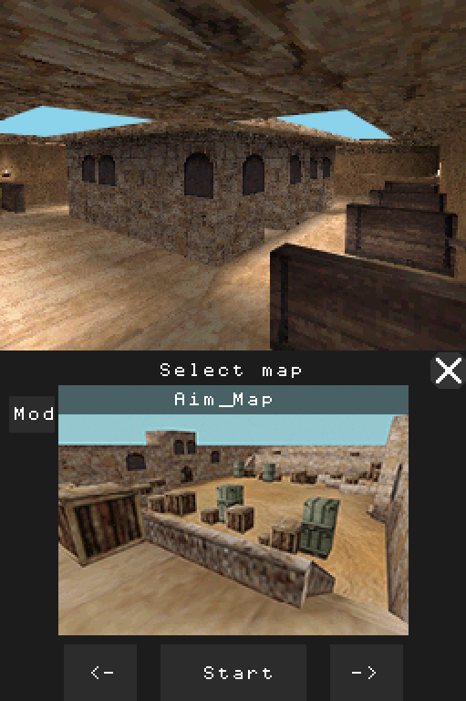
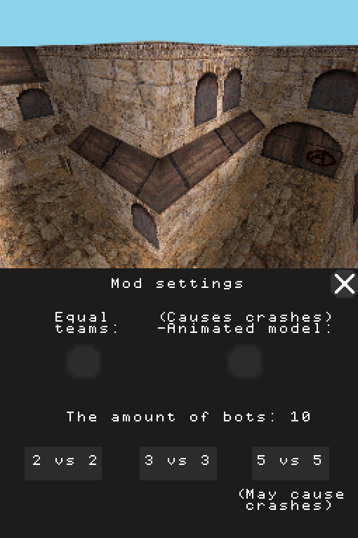

# Counter Strike Nintendo DS
**Counter Strike demake on Nintendo DS with online multiplayer** (Works on **emulator** and on **real hardware**).

# New version! 1.1.2
The game now ported to a new version of Nitro Engine (0.16) 
New maps(Aim_map, "$2000$", fy_snow, De_Mirage,), 
New modes(Deathmatch, Gungame\Arms Race), 
New "Mod" menu,  
New texture for Terrorists, 
New player models (Animated and Static), 
Now you can choose to which server to connect via IP.

  

For **multiplayer** on **emulator**, please use [melonDS](https://melonds.kuribo64.net/downloads.php). 
There is no emulator with **online** support on **Android** at this time. 

## How to install the game

### On DS flashcard
1. Put the .nds on the microSD card

### On DSi/3DS SD card
1. Install [TWiLight Menu++](https://wiki.ds-homebrew.com/twilightmenu/installing)
2. Put the .nds on the SD card
3. In TWiLight Menu++, find the game and press Y on it
4. Set **Run in** to **DS mode*

## Network Setup
- Create a Wi-Fi network without a password or with WEP security. You can use your Android phone, a compatible router, or a Linux/MacOS computer with Wi-Fi adapter to do a hotspot
### On DS
1. Start a game that **supports online multiplayer** like **Mario Kart DS**
2. Open the **Wi-Fi setup** and select an available Wi-Fi slot
3. Search for an access point and add your Wi-Fi

### On DSi
1. Open **System Settings**
2. Open **Internet**
3. Open **Connection Settings**
4. Select an available Wi-Fi slot (it must be Connection 1, 2, or 3!)
5. Search for an access point and add your Wi-Fi

### On 3DS
1. Open **Settings**
2. Open **Internet Settings**
3. Open the **Nintendo DS Connection** menu and select an available Wi-Fi slot
4. Search for an access point and add your Wi-Fi

## How to compile the game
1. Install BlocksDS: https://blocksds.skylyrac.net/docs/setup/
2. Install Nitro Engine 0.15.4 in one of the following ways:
  - using the package: `wf-pacman -Sy blocksds-nitroengine`;
  - from the source code: in the `nitro-engine-0.15.4` folder, run `make install`. 
  This will build both versions of the library, `libNE` and `libNE_debug`.
3. In the **MSYS2 UCRT64** terminal (not cmd.exe), navigate to the game folder
(`cd /opt/Counter-Strike-nds`) and run `make`. This will create the file `counter_strike_ds.nds`.

Note : To avoid coding collisions, path finding..., there is an Unity project to export code : https://github.com/Fewnity/Counter-Strike-DS-Unity-Project

## TODO
- [ ] Ad hoc (Ni-Fi) multiplayer
- [ ] Disable sleep mode in multiplayer : **?**
- [ ] Add fall damage
- [ ] Smoke doesn't affect bots at this time
- [ ] Languege system
- [ ] Add more maps
- [ ] Add hostage rescue mode
- [ ] make a few strategies for bots
- [ ] Add dropping weapons
